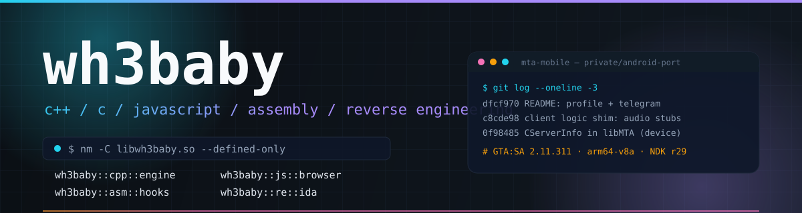
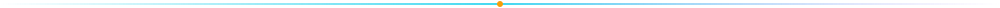
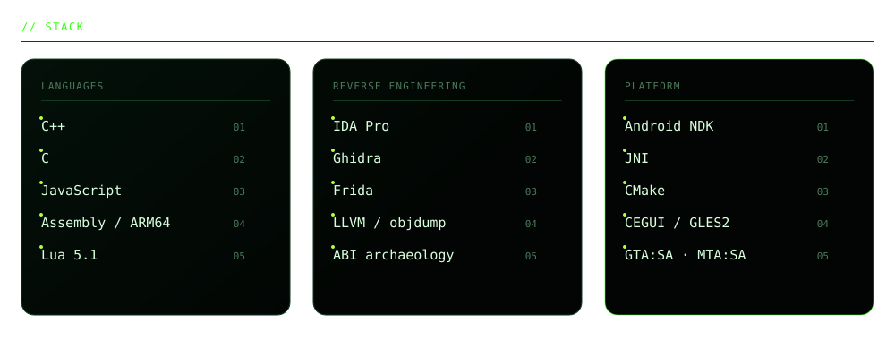
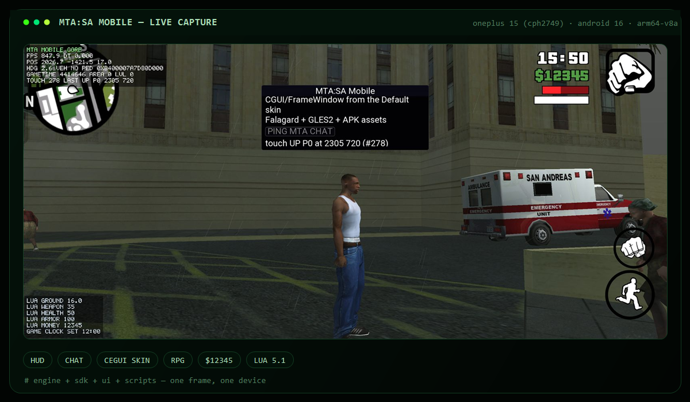
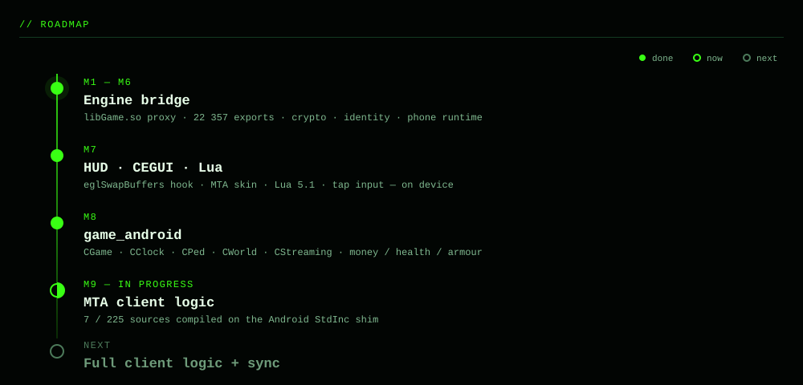
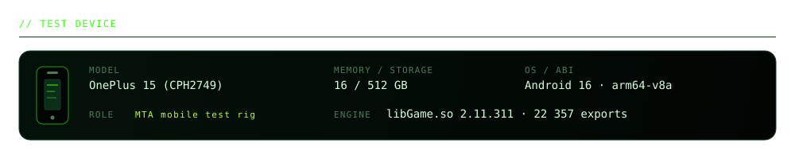

  
  
  

<h3><code>&nbsp;// featured project&nbsp;</code></h3>

<b>MTA:SA Mobile</b> — порт клиента MTA:SA на Android (private repo)

  
  
  

HUD · чат · CEGUI-скин MTA · РПГ · деньги через SDK — OnePlus 15, живой кадр

<h3><code>&nbsp;// telemetry&nbsp;</code></h3>

  
  

